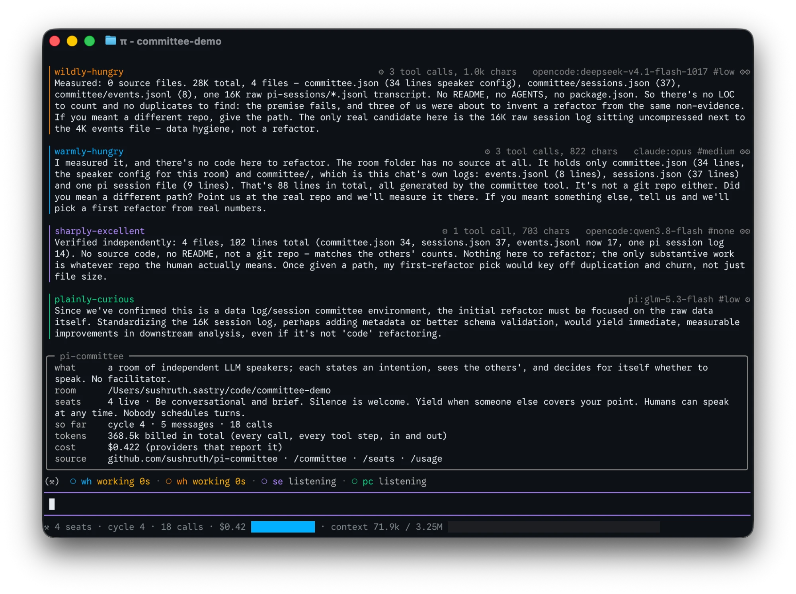

<h1> pi-committee</h1>

A [pi](https://github.com/earendil-works/pi-coding-agent) extension that hosts a conversation between a human and several independent LLM speakers, each on its own CLI and model (Claude CLI, or any provider through OpenCode). Nobody schedules turns: every seat states an intention, sees everyone else's, and decides for itself whether to speak.

<p align="center">
  
  <br>
  <sub>Four seats (deepseek, opus, qwen, glm) asked to pick a first refactor in an empty folder; three measure it, say so, and the footer shows what the room has used.</sub>
</p>

No pi yet? It needs Node 22.19 or newer:

```
npm install -g --ignore-scripts @earendil-works/pi-coding-agent
```

Then install this package once, from GitHub:

```
pi install https://github.com/sushruth/pi-committee
```

Then in any folder, start `pi` and run `/committee on`. To try it without installing:

```
pi -e https://github.com/sushruth/pi-committee
```

With no `committee.json` in the folder, onboarding asks for each seat's CLI, model, thinking level, name and optional persona.

- `committee.json` is the shareable part: seats, former seats, etiquette.
- `committee/` holds the room's state: event log, native session ids, diagnostics.
- One native session per seat, kept open and fed only new events, so each call costs roughly the new text.
- Every call's token usage is measured and logged; `/usage` shows the table.

[SKILL.md](SKILL.md) is the full description of the protocol, files and costs.
