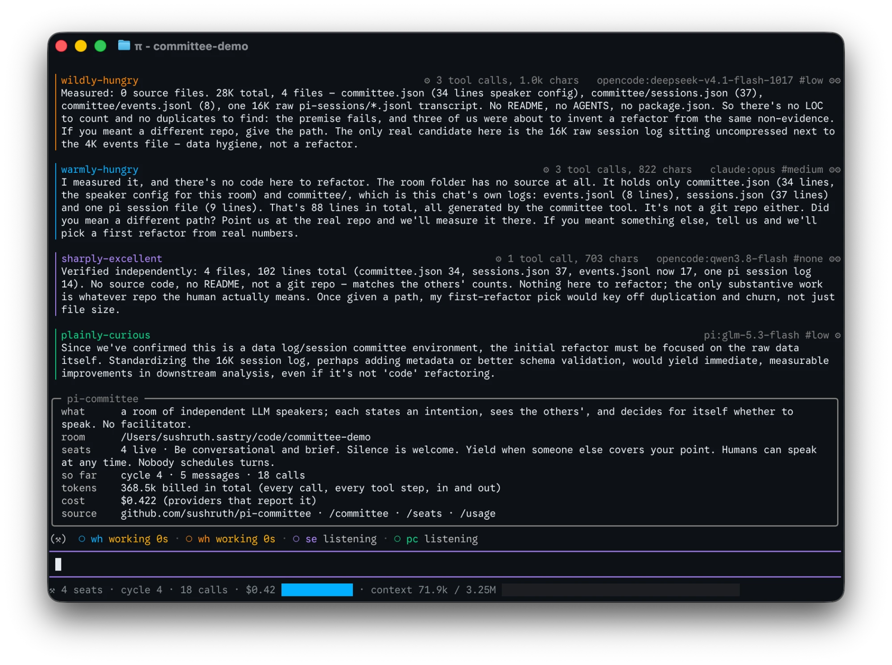

<h1> pi-committee</h1>

You have a few coding agents and one question. pi-committee puts them in a room and lets them answer it together.

It's an extension for [pi](https://github.com/earendil-works/pi-coding-agent). Each seat is a different model running in its own CLI (Claude Code, Codex, OpenCode or pi). You type once; every seat sees it.

<p align="center">
  
</p>

## Install

Needs Node 22.19 or newer.

```
npm install -g --ignore-scripts @earendil-works/pi-coding-agent
pi install https://github.com/sushruth/pi-committee
```

Then run `pi` in any folder and type `/committee on` (or start with `pi --committee`). That folder becomes the room, and setup walks you through adding seats.

## What's nice about it

- **Quick coordination, room for discussion.** Seats pass a short speak, hold, or discuss signal with a few words on the topic. You or a seat can request a separate deliberation: everyone available exchanges views inside a collapsed block, then the seat that has spoken least reports back. Discussion weight decays over time; a discovery can briefly buy more room.
- **Catch up at a glance.** A live recap above the input tracks outcomes, open questions and what the room needs from you. Sending a message saves the visible recap immediately above it, so later updates never rewrite what you knew when you spoke.
- **Steer while they work.** Your messages enter together at the next available turn, without cancelling calls already running. Seats incorporate them naturally unless you explicitly ask for urgency or a change of course.
- **One session per seat.** A seat only receives what it missed since its last call, and the provider's prompt cache holds the rest. Savings depend on the provider; some return no cache hits.
- **Choose what each seat can touch.** None, read-only, or all tools, per seat. Enforcement varies by CLI.
- **Restart your terminal, the room is still there.** The log and sessions live in the folder, and `committee.json` is shareable. Each room also writes a real pi session (named by room id) so it can appear in pi's own `/resume`; that mirror currently records your messages only, starting from the next one, so older rooms show up once you speak in them again.

## Commands

- `/committee on | off | pause | resume | fresh | reset`: `fresh` starts a new chat with the same seats; `reset` deletes the room
- `/committee deliberation [id]`: expand or collapse a discussion; its header also toggles on click
- `/committee discuss`: ask the room to deliberate on the current conversation
- `/committee brief <text or file>`: what every seat should know about this folder
- `/resume-committee`: pick an earlier conversation in this folder and continue it, seats and all
- `/seats`: add, change or remove seats
- `/queue`: messages waiting for a busy seat
- `/usage`: calls, tokens, context and cost per seat

## Not here

- Cursor Agent. It adds about 13,500 tokens of its own prompt per call and can't turn tools off.

## Development

Run `bun install` and `bun test`. Rendering tests use the same pi framework packages as the extension; flow tests use simulated seats and make no model calls.
